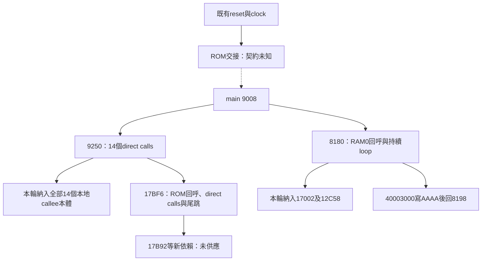

# ID2966 啟動後的初始化與循環執行

最新入口是 `python verify-extension.py`，預設使用`evidence/core-flow-integration.json`。它會從本機原BIN重新建立前一輪main／callee、vector／IRQ、clock與reset基線，再加入本輪全部19個本地本體。C11／C++17加RV32內嵌組語保留原指令與引用，未宣稱恢復原始C型別或完整來源碼。

固定來源為76800B的ID2966，伺服器標籤V4.1.60，SHA256 `0ee64183daaa140acac7dbb6c0f7c26d1fe625344ed158151731a9b2632fb667`。8000為既有向量／reset證據支持的地址模型，工具指定地址不等於原硬體載入位置已證明。

## 原執行流程與本輪納入範圍

圖中的caller continuation只表示原指令的「callee若正常返回」路徑。9250還原frame後尾跳17BF6，17BF6再尾跳17B92；後者尚未提供，因此初始化的跨地址語意並未閉合。main的RET回到entry時保存的ra，ROM交接時該值仍未知。

| 本地capture | bytes | 已取證的內容 |
|---|---:|---|
| 8180..81AA | 42 | RAM0間接呼叫、17002／12C58兩個直接呼叫、原迴圈與數值MMIO store |
| 9250..9290 | 64 | 14個direct calls與尾跳17BF6，沒有合成RET |
| 17BF6..17C4E | 88 | 三處ROM表回呼、兩個direct calls、尾跳17B92與三組PCREL |
| 初始化第一層14個callee＋loop兩個callee | 2594 | 16個完整本地CFG，845條原指令；不遞迴補未知callee |

16個第一層入口為18834、9A42、1973C、9F4C、131C2、8E88、9B4E、9958、9F12、12D92、14C8A、154A6、17040、173A2、17002、12C58。各自extent、原始分支、尾跳、MMIO／GP／PCREL來源及限制見交付的initialization-review。18834、12C58、12D92的第一RET後仍有原分支可達的指令，均保留；相接的區段沒有重複配置。

本輪新增2788B code、19個section-backed FUNC與214筆semantic relocations（core27＋initialization187）。模組內每個direct control operand均有對應引用，32組AUIPC pair各回指自己的HI anchor。Flash未知材化地址保持opaque，沒有因地址看似程式就猜成已恢復的函式或descriptor常數。

## 已通過的靜態整合檢查

| 範圍 | code | RO | allocated sections | semantic relocations |
|---|---:|---:|---:|---:|
| 前一輪main／七callee入口 | 1706 | 456 | 26 | 223 |
| 本輪core與初始化第一層 | 4494 | 456 | 45 | 437 |

4950B file-backed bytes在數值地址配置中逐byte對回原映像；原有code／initializer／vector／handler storage及223筆舊引用完整保持，引用比較保留multiplicity。C11與C++17的整合物件及數值witness各自逐byte相同。

仍只有一個35160B NOBITS RAM carrier。24個RAM address views為同section、NOTYPE、size0，不配置新storage或提供假值。它們只證明引用位址與既有配置的關係，不能證明caller／ROM真正存取的extent、runtime內容或物理記憶體相容性。

新驗證器hashpin模組source／header／plan及獨立CFG證據，追溯每層baseline來源／工具／收據digest。原始bit解碼另核每個直接branch／jump。實際ELF symtab的ABS-provider反例由同一provider gate拒絕；舊provider及RAM views保持。合法的ELF local mapping symbols可在不同object同名，不能以name-dict誤判；其指令storage與semantic references仍全部核對，exported provider另核section／type／size／offset。

## 目前未解的引用與ROM契約

最終嚴格link精確保留79個UND，並拒絕產生strict ELF或BIN。79項各有不同原數值地址，分類如下；它們是目前已捕獲範圍的引用前緣，並非整份韌體的總缺口。

- 68個直接程式控制目標，尚待追實際本體與後續依賴。
- 2個只在本輪材化的code-entry addresses：176F8與178F8；不是本輪新增的direct call。其完整本體／ABI未提供。
- 8個Flash opaque materialized addresses：8614、8C82、9AD2、16F00、172B6、19DEC、19DFC、1AB34；code/data語意及extent未知。
- resident ROM入口40000，本體與交接契約未知。

已捕獲code中另有48處間接callsite（不含正常RET）；pointer實際值、callee本體／ABI與效果未因此閉合。新增core的ROM表slot40048／40080、原有4004C／4007C等都只是數值pointer來源，不是已取得的函式body。a1=0、a2=3或115的形狀不足以直接命名SDK函式，也不能拿argument當已證memory-access extent。詳見各per-site來源與保守條件切片。

`ADDRESS-WITNESS-ONLY.elf`只填上述79個原地址，供4950B靜態位置／bytes核對，沒有提供缺少本體或資料；禁止當成候選韌體執行或燒錄。`core-flow-only-integration.json`則是194B core中間階段的明確獨立scope，會留22 UND，不能冒充最新全整合。

## 原目標仍需證明的條件

精確MCU／PCB／晶片印字、實體RAM／stack／MMIO、root／BOOT、resident ROM版本／ABI、IRQ向量長度及中斷契約、initializer raw pointers、完整必要功能／資料閉包、最終映像配置與原BLE OTA驗收仍未證實。ID2966對這顆TSL9的完整硬體適用性未知；使用者目前無法讀取晶片印字。

重建及取證只使用本機原bytes、host編譯器／linker與ELF解析；沒有執行或模擬原始／重建RV32，也未連線裝置、刷寫或發額外API請求。下一步應沿79項引用與48個callsite追真實來源，優先保留ROM、材化位址與直接callee的不同角色。

交付證據在`../../analysis/v4160-core-flow-2026-10-20/`；指定專案的fresh build及與獨立審閱產物的SHA比對，以`destination-verification.json`為準。
