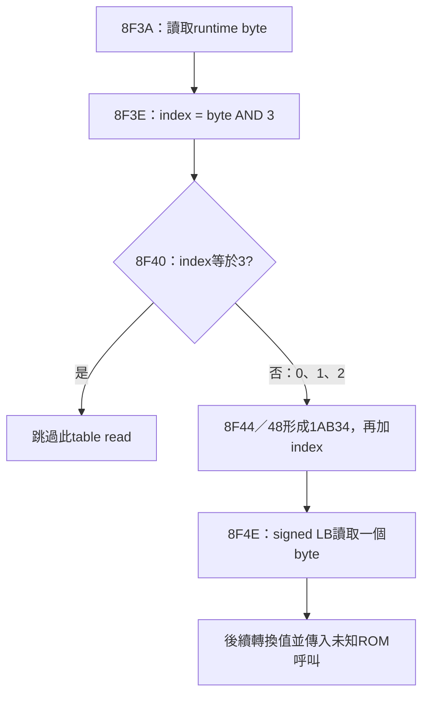

# ID2966 取址引用、回呼本體與有界唯讀範圍

最新重做入口：`python verify-extension.py --spec evidence/materialized-integration.json`。本層以先前core-flow為基線，新增七個本地程式capture及1AB34的三byte observed-read view。預設不帶`--spec`仍重做凍結的core-flow階段，因此本層能從同一verifier建立fresh基線而不遞迴呼叫自己。

來源仍固定為ID2966／伺服器標籤V4.1.60，76800B，SHA256 `0ee64183daaa140acac7dbb6c0f7c26d1fe625344ed158151731a9b2632fb667`。原指令以C11／C++17加RV32 inline assembly表示；編譯與ELF一致不等於恢復完整原始C來源、型別或硬體ABI。

## 七個原始程式區段

| 原半開範圍 | bytes | 原符號與保留的界限 |
|---|---:|---|
| 8614..888C | 632 | 原opaque address8614保留NOTYPE0 view，另有captured-body FUNC helper |
| 8C82..8E18 | 406 | 同上；有來源caller傳入ROM table slot40080，實際ROM作用未知 |
| 9AD2..9AE4 | 18 | 同上；caller記錄地址到slot+4或作90B0 argument，不推定原C型別 |
| 16F00..16FB6 | 182 | 同上；恰接已有IRQ capture，沒有覆蓋或重複配置 |
| 172B6..17320 | 106 | 同上；未知callee仍保留，不延伸到相鄰程式 |
| 176F8..1787C | 388 | 原材化code-entry現由真實capture提供；1787C本身仍是外部目標 |
| 178F8..17948 | 80 | 同上；保留原frame／指令及外部引用，無C-callable prototype假設 |

1812B共七sections，原bits有限CFG與r2逐指令核對，沒有holes、unsupported指令或預算截斷；callee continuation以「若正常返回」為條件。兩入口原已有材化code-entry角色；其餘五個原opaque名稱仍為同section、NOTYPE、size0 address views，與另外的FUNC helper分開。FUNC標記表示捕獲的指令body，沒有把原opaque名稱升格為已知原C函式型別。

本模組117筆semantic relocs＝93個direct controls＋12組AUIPC pairs（24筆HI／LO，含兩個LO12_S store）。各自回指自己的HI anchor，不把S-type store錯套成I。Standalone仍有12個direct-code、4個opaque-address及4個RAM-address UND，不遞迴假造callee；31個新增間接callsite也只保留原指令及caller資料流，不知pointer實值／callee ABI。

## 1AB34的三byte local-read證據

此本地guard與資料流覆蓋所有可達table-read index，所以最小enclosing observed-read view為`[1AB34,1AB37)`，共3B。它不是原始完整object／descriptor大小的證明，也不聲稱全映像所有可能alias或未知ROM讀取皆只限三byte。完整raw-bit範圍與callee返回條件見address-review。

一個OBJECT size3 raw-byte carrier只配置這3B一次；原`__tsl9v4160_address_1ab34`仍是同section、NOTYPE、size0 view。原C-array加alias寫法曾被audit擋下，因LLVM使alias繼承OBJECT型別；最終以兩個明示原生labels維持OBJECT3及NOTYPE0，沒有放寬檢查。真ABS-view與第三byte破壞反例均被拒絕。

19DEC／19DFC在已見caller中仍只當未知ROM argument，13／16等參數不足以證明實際讀取extent或型別，因此沒有生成它們的provider、補零或借用其他版本資料。全原image相鄰AUIPC候選掃描只提供有界來源線索，不保證發現所有absolute、indirect或runtime references。

## 整合與未完成條件

| 階段 | code | RO | allocated sections | semantic relocs |
|---|---:|---:|---:|---:|
| core-flow基線 | 4494 | 456 | 45 | 437 |
| 本輪取址／回呼／local-read整合 | 6306 | 459 | 53 | 554 |

6765B file-backed bytes（52個file-backed sections）均對回同版本原始地址與bytes，另有原35160B單一NOBITS carrier，共53allocations。所有舊storage、exported providers、437筆舊semantic引用multiset均保留。C11與C++17整合物件及數值witness各自逐byte相同。26個RAM views皆為同carrier、NOTYPE、size0；新增BDF8／C8AE只有地址身分，不提供runtime資料值／假型別／新storage。

本輪14個新增exported符號分為7個captured FUNC、5個code-address NOTYPE views、1個OBJECT3及1個RO-address NOTYPE view，不能全部稱為14個函式。原四個baseline ABS literal addresses只表示SP與RAM0/4/8的原數值，並未被做成memory或code providers。

嚴格link仍拒絕84個UND，沒有strict ELF或最終BIN：78個直接code targets、5個opaque materialized addresses（17666、19DE0、19DEC、19DFC、1AAE8）及ROM40000；84項數值位址彼此不同。已捕獲程式另有79個間接callsite，pointer值／真正target body／ABI未全部解析。這是當前捕獲範圍的前緣，不是整份韌體只剩84個缺口。

`ADDRESS-WITNESS-ONLY.elf`只填84項原數字來核對6765B位置／bytes，不供應缺少程式或資料，不可執行／燒錄。當前實際ABS countercase針對一個新NOTYPE address view；其同gate拒絕驗證不能改說成本層專測FUNC替換。舊層真FUNC countercase及所有舊provider身分另保持。

精確MCU／PCB／晶片印字、實體memory／stack／MMIO、root／BOOT、ROM版本／ABI、IRQ契約、完整功能及資料閉包、最終映像配置與原BLE OTA驗收仍未證實。使用者目前無法讀取晶片印字；ID2966硬體適用性仍未知。未執行／模擬RV32，未連線／刷寫硬體或發額外API請求，原完整goal未達成。

交付證據在`../../analysis/v4160-materialized-2026-10-20/`。指定專案的fresh基線／本層build、實際artifact讀回與已獨立審閱stage的SHA比對，以`destination-verification.json`為準。
