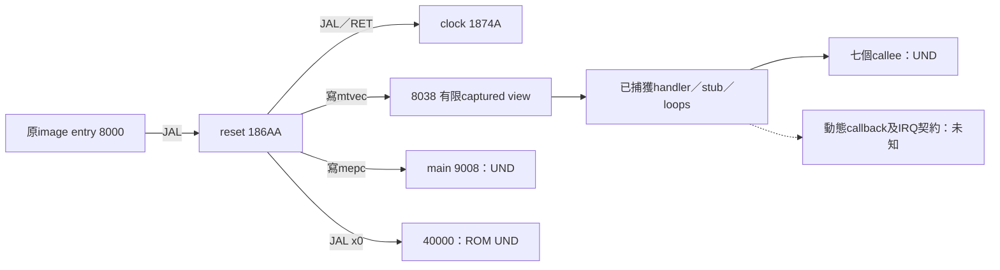

# ID2966 候選映像：原生執行層整合

目前最新入口為 `python verify-vector-platform.py`，固定ID2966的SHA256為`0ee64183daaa140acac7dbb6c0f7c26d1fe625344ed158151731a9b2632fb667`。程式為C11／C++17加RV32 inline assembly，保留原指令ABI、MMIO及特殊中斷frame；沒有假造一般C中斷prologue。Python只執行編譯、連結、原始bytes與ELF取證，不執行或模擬RV32。

| 獨立驗證入口 | 內容 | 該階段明示UND |
|---|---|---:|
| `verify.py` | reset138B、initializer128B、RAM數值carrier | 4 |
| `verify-platform.py` | 加入真實clock234B／93指令 | 3 |
| `verify-vector-platform.py` | 再加入vector捕獲視窗、57loops、六handler與四stub | 9 |

UND增加是因新納入handler帶出七個真實callee，而不是回退或用dummy補齊。三個入口各有明確的scope及收據；上述數量都不是整份韌體缺口總數。

## 新整合的實體bytes與符號

- 共1322B程式碼、456B唯讀資料（328B vector captured view＋128B initializer），17個非空配置sections；各原始byte只配置一次。
- 一個35160B NOBITS RAM carrier保持；七個新address views是同section的NOTYPE、size0符號，沒有配置新storage或假設其值。別名來源為原PC-relative位址與已核對的reset RAM範圍。
- 共211筆semantic relocations：原reset14、clock7、vector/IRQ190。包含62筆vector word的R_RISCV_32、完整57個不同self-loop目的、六handler的branch/call與HI/LO；S-type store用LO12_S，沒有誤套LO12_I。
- Clock現在是section-backed FUNC234，vector_base是指向實際capture的size0 NOTYPE位址；numeric witness沒有以ABS數字取代這兩個實作。reset與clock舊bytes、128B初始化資料及RAM extent完整保持。

這是原指令的靜態引用圖，沒有觀察到硬體執行。57個2B loops各跳回自己；未被vector引用的六個仍保留原bytes。RAM4 wrapper是C.JALR，正常callback RET返回18746後才MRET。第一個MRET／RET不是通用的函式截斷條件，原CFG可達的後段一併保留。

## 真實依賴與不能升格的結論

嚴格最終link保持拒絕9項：main9008、resident ROM40000及七個direct callees81B0、93EE、12BC8、18D78、18E86、19272、19296。未提供任何替代stub，沒有最終BIN。下一步應回到各原始entry追真實本體及其依賴。

九個UND之外另有四處動態呼叫：84DA讀取`*(0x20004180)`後JALR；98F8讀取`*(0x40068)`後C.JALR；994C讀取`*(0x2000BEC8)`後C.JALR；18744才是讀取`*(0x20000004)`的RAM4 C.JALR。以上僅確認原指令計算的位址，實際pointer值、callee本體與執行契約仍未知，不能算作已解決的程式依賴。

82words／328B僅是來源8038..8180的有限captured view。最後非零slot69與其後12個零words，不足以證明真實IRQ表長70或82、平台mode3 dispatch、實體中斷ABI。Initializer raw pointers、RAM0/4/8內容、ROM／callback ABI、必要程式依賴及整份映像仍未閉合。不能因numeric layout成功就宣稱可開機或可刷寫。

`ADDRESS-WITNESS-ONLY.elf`只把九個尚缺入口填上原始數字，靜態核對1778B的原始位置與bytes；沒有配置那些callee/main/ROM程式。它是數值夾具，禁止當候選韌體執行或燒錄。使用者目前無法提供晶片印字；精確MCU／PCB／RAM／stack、root／BOOT及原藍牙OTA驗收仍未證實，ID2966的硬體適用性仍未知。

## 驗證範圍

兩語整合物件與numeric witness各自逐byte相同，211筆引用、全部captured bytes、既有reset／clock／initializer及NOBITS extent均核對。Standalone vector audit還拒絕三個錯誤反例：RAM4 call錯位元、缺R32、LO12_S錯成I；整合audit另實際修改ELF把RAM alias改為ABS，必須被拒絕。這些是取證與檢查器反例，不是硬體測試。

預設每次使用已下載的本機BIN，在唯一build目錄重新建立clock基線與vector元件；可指定`--firmware <路徑>`，或`--baseline-receipt <先前clock收據>`重用通過完整來源／工具／物件hash核對的基線。沒有網路、裝置寫入、原始或重建RV32執行／模擬。
